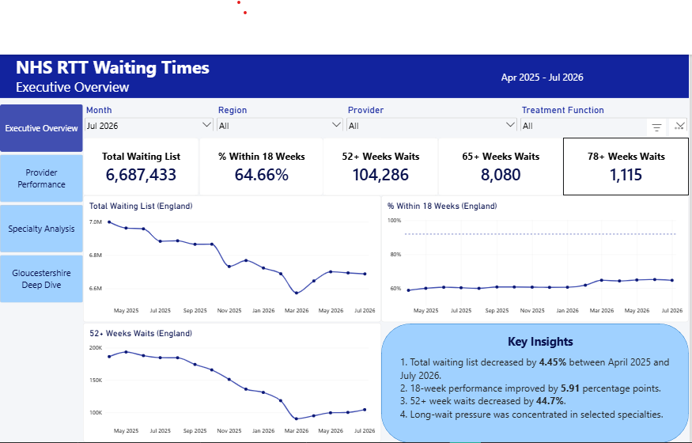
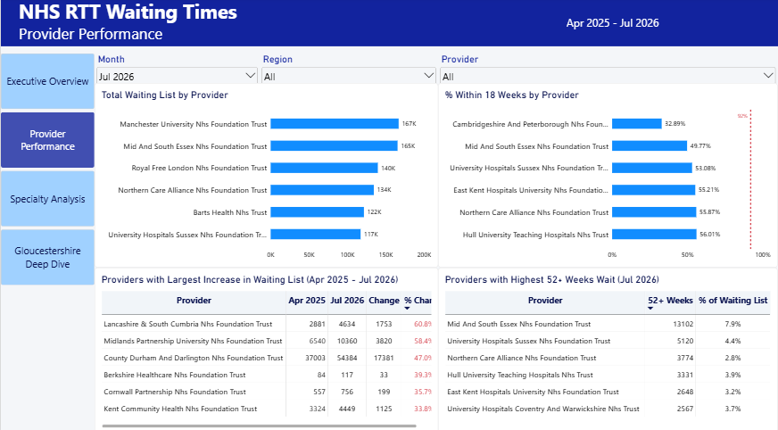
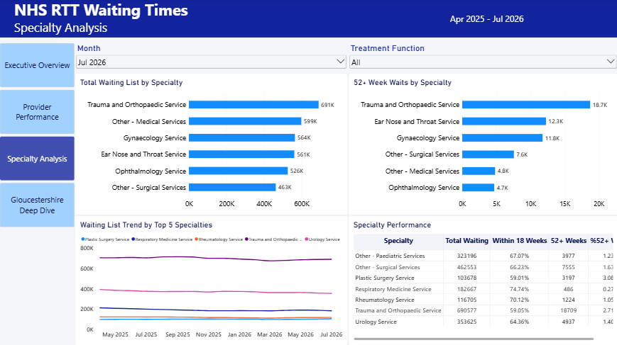
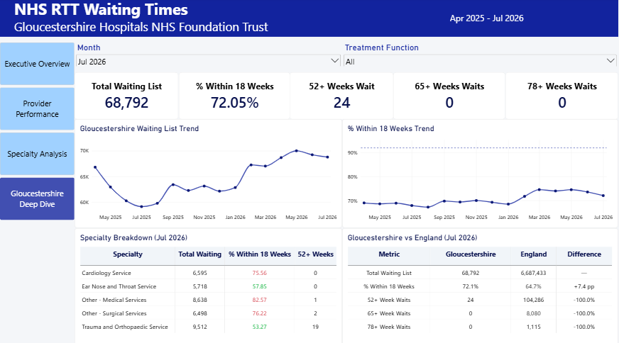

# NHS Referral-to-Treatment Waiting Times Analysis

## Overview

This project analyses NHS England **Referral to Treatment (RTT) incomplete pathway data** to understand elective waiting-list pressure across providers and treatment functions.

The analysis covers **April 2025 to July 2026** and combines Python, MySQL and Power BI to create an end-to-end healthcare analytics project.

The project focuses on:

- overall waiting-list trends;
- performance within 18 weeks;
- long waits of 52+, 65+ and 78+ weeks;
- provider-level performance;
- treatment-function / specialty pressure;
- month-on-month changes;
- provider improvement and deterioration; and
- a focused case study of **Gloucestershire Hospitals NHS Foundation Trust**.

> The data contains RTT pathways, not unique individual patients.

---

## Business Problem

NHS performance teams need to understand not only how large elective waiting lists are, but also where pressure is concentrated and whether performance is improving over time.

The project was designed around the following questions:

1. How has the total RTT waiting list changed over time?
2. Is the percentage of incomplete pathways within 18 weeks improving?
3. How are 52+, 65+ and 78+ week waits changing?
4. Which NHS providers have the largest waiting lists?
5. Which providers have the lowest 18-week performance?
6. Which providers have improved or deteriorated most?
7. Which treatment functions contribute most to waiting-list pressure?
8. Which specialties have the greatest number of long waits?
9. How does Gloucestershire Hospitals NHS Foundation Trust compare with the wider provider dataset?
10. Which Gloucestershire specialties show the greatest pressure?

---

## Project Workflow

```text
NHS England RTT Excel Files
            │
            ▼
    01 Data Understanding
            │
            ▼
       02 Data Cleaning
            │
            ▼
03 Multi-Month Preparation
            │
            ▼
 04 Exploratory Data Analysis
            │
            ▼
       05 MySQL Analysis
            │
            ▼
     06 Power BI Dashboard
            │
            ▼
      Portfolio Insights
```

---

## Tools Used

- **Python**
  - pandas
  - NumPy
  - Matplotlib
  - openpyxl

- **SQL**
  - MySQL
  - MySQL Workbench
  - Common Table Expressions
  - Window functions
  - Aggregations
  - Analytical views

- **Power BI**
  - Data modelling
  - DAX
  - KPI cards
  - Time-series analysis
  - Slicers
  - Conditional formatting
  - Page navigation
  - Interactive dashboards

- **Git / GitHub**
  - Project structure
  - Version control
  - Portfolio presentation

---

## Dataset

The project uses NHS England **Consultant-led Referral to Treatment Waiting Times** data.

The analysis focuses on the **Incomplete Provider** datasets.

Each row represents a:

> **Provider + Treatment Function + Reporting Month**

The source data includes:

- provider code;
- provider name;
- treatment-function code;
- treatment function;
- weekly waiting-time bands;
- total incomplete pathways;
- total within 18 weeks;
- percentage within 18 weeks;
- median waiting time;
- 92nd percentile waiting time;
- 52+ week waits;
- 65+ week waits;
- 78+ week waits.

The project uses monthly data from:

**April 2025 to July 2026**

---

## Important Data Structure

Each provider contains treatment-function rows plus a provider total row:

```text
C_100   General Surgery
C_101   Urology
C_110   Trauma and Orthopaedics
...
C_999   Total
```

`C_999` already represents the provider-level total.

Therefore:

- provider-level analysis uses `C_999`;
- specialty analysis excludes `C_999`;
- provider totals must never be added to specialty rows.

This avoids double-counting.

---

## Data Understanding

The first notebook inspects the structure of the July 2026 workbook before any cleaning is performed.

Key checks include:

- worksheet identification;
- correct Excel header row;
- dataset dimensions;
- provider count;
- treatment-function coverage;
- duplicate checks;
- weekly waiting-band identification;
- total-pathway reconciliation;
- 18-week reconciliation;
- non-numeric waiting-time values.

### Validation

The 105 detailed waiting-time bands were independently summed and compared with the published:

```text
Total number of incomplete pathways
```

The values reconciled successfully.

The first 18 waiting bands were also independently summed and reconciled with:

```text
Total within 18 weeks
```

This adds an additional data-quality check before analysis.

---

## Data Cleaning

The cleaning stage:

- removes fully empty Excel columns;
- standardises column names to `snake_case`;
- renames all 105 waiting-time bands;
- converts `-` waiting-time values to missing values;
- converts percentage values to a consistent scale;
- creates additional KPIs;
- adds reporting-period metadata;
- labels provider-total and treatment-function rows;
- performs duplicate checks;
- performs logical validation;
- validates long-wait measures.

### Derived Fields

Examples include:

```text
over_18_weeks
pct_over_18_weeks
reporting_month
reporting_period
row_type
```

---

## Multi-Month Preparation

A reusable cleaning function was created so monthly files do not need to be manually cleaned one at a time.

The pipeline:

1. identifies the reporting month from the filename;
2. detects the actual header row;
3. loads the Provider worksheet;
4. standardises the schema;
5. validates weekly waiting bands;
6. validates 18-, 52-, 65- and 78-week measures;
7. appends the cleaned month to the combined dataset.

Two main processed datasets are created:

```text
rtt_incomplete_provider_apr2025_jul2026_clean.csv
rtt_provider_totals_apr2025_jul2026.csv
```

The first supports detailed provider/specialty analysis.

The second supports provider-level and national trend analysis without double-counting.

---

## Exploratory Data Analysis

Python was used to investigate:

- total waiting-list trends;
- month-on-month change;
- weighted 18-week performance;
- 52+, 65+ and 78+ week waits;
- provider rankings;
- provider improvement and deterioration;
- treatment-function pressure;
- Gloucestershire trends;
- Gloucestershire versus overall performance.

### Weighted KPI Calculation

National 18-week performance was calculated using:

```text
SUM(within_18_weeks)
--------------------  × 100
 SUM(total_waiting)
```

A simple average of provider percentages was deliberately avoided because it would give small and large providers equal weight.

---

## SQL Analysis

The cleaned datasets were loaded into MySQL as:

```text
rtt_provider_totals
rtt_full
```

The SQL analysis demonstrates:

- database creation;
- data-quality checks;
- provider/month validation;
- weighted KPI calculations;
- month-on-month analysis;
- `LAG()` window functions;
- Common Table Expressions;
- provider rankings;
- first-to-latest comparisons;
- specialty analysis;
- Gloucestershire benchmarking.

### Power BI Views

Three reusable SQL views were created:

```text
vw_national_monthly
vw_provider_monthly
vw_specialty_monthly
```

These simplify the Power BI model and reduce repeated business logic inside the report.

---

## Power BI Dashboard

The Power BI report contains four pages.

### 1. Executive Overview

Purpose:

Provide a high-level view of overall RTT performance.

Includes:

- Total Waiting List
- % Within 18 Weeks
- 52+ Week Waits
- 65+ Week Waits
- 78+ Week Waits
- Waiting-list trend
- 18-week performance trend
- Long-wait trend
- Key insights



---

### 2. Provider Performance

Purpose:

Identify providers experiencing the greatest waiting-list pressure.

Includes:

- Total Waiting List by Provider
- % Within 18 Weeks by Provider
- Providers with Largest Increase in Waiting List
- Providers with Highest 52+ Week Waits
- Provider filters
- Month filters



---

### 3. Specialty Analysis

Purpose:

Identify treatment functions contributing most to waiting-list pressure.

Includes:

- Total Waiting List by Specialty
- 52+ Week Waits by Specialty
- Specialty waiting-list trends
- 18-week performance
- Specialty performance table



---

### 4. Gloucestershire Hospitals Deep Dive

Purpose:

Provide a focused local case study of:

**Gloucestershire Hospitals NHS Foundation Trust**

Provider code:

```text
RTE
```

Includes:

- Total Waiting
- % Within 18 Weeks
- 52+ Week Waits
- 65+ Week Waits
- 78+ Week Waits
- Waiting-list trend
- 18-week performance trend
- Specialty breakdown
- Gloucestershire vs England comparison



---

## Gloucestershire Case Study

The July 2026 provider-total record for Gloucestershire Hospitals NHS Foundation Trust reports approximately:

| KPI | July 2026 |
|---|---:|
| Total incomplete pathways | 68,792 |
| Within 18 weeks | 49,568 |
| % within 18 weeks | 72.05% |
| Median waiting time | 10.79 weeks |
| 92nd percentile waiting time | 33.83 weeks |
| 52+ week waits | 24 |
| 65+ week waits | 0 |
| 78+ week waits | 0 |

The dashboard extends this snapshot by examining the Trust over the full analysis period and comparing its performance with the wider dataset.

---

## Key Analytical Principles

### Do not sum monthly waiting-list snapshots

RTT waiting-list data represents monthly snapshots.

For example:

```text
Apr 2025 waiting list
+
May 2025 waiting list
+
Jun 2025 waiting list
```

does **not** represent a meaningful total number of people waiting.

For ranking visuals and KPI cards, a selected reporting month is used.

Trend visuals show multiple monthly snapshots across time.

---

### Do not average provider percentages

The national percentage within 18 weeks is calculated from pathway counts rather than:

```text
AVG(provider_percentage)
```

This prevents small providers from having the same influence as much larger providers.

---

### Do not double-count `C_999`

The provider total row is analysed separately from treatment-function rows.

---

## Project Structure

```text
nhs-rtt-waiting-times-analysis/
│
├── data/
│   ├── raw/
│   │   └── monthly/
│   │
│   └── processed/
│       ├── rtt_incomplete_provider_apr2025_jul2026_clean.csv
│       └── rtt_provider_totals_apr2025_jul2026.csv
│
├── notebooks/
│   ├── 01_data_understanding.ipynb
│   ├── 02_data_cleaning.ipynb
│   ├── 03_multi_month_data_preparation.ipynb
│   └── 04_exploratory_analysis.ipynb
│
├── sql/
│   └── 05_sql_analysis.sql
│
├── powerbi/
│   ├── 06_power_bi_dashboard_build_guide.md
│   └── 06_power_bi_measures.dax
│
├── reports/
│   └── figures/
│       ├── powerbi_01_overview.png
│       ├── powerbi_02_providers.png
│       ├── powerbi_03_specialties.png
│       └── powerbi_04_gloucestershire.png
│
├── README.md
│
└── requirements.txt
```

---

## Skills Demonstrated

This project demonstrates practical experience in:

### Data Cleaning

- Excel ingestion
- missing-value handling
- datatype conversion
- schema standardisation
- data validation
- reconciliation checks

### Python

- pandas
- NumPy
- Matplotlib
- reusable functions
- multi-file processing
- exploratory analysis

### SQL

- MySQL
- joins
- aggregations
- CTEs
- window functions
- `LAG()`
- ranking
- weighted KPI calculations
- views

### Power BI

- MySQL connection
- data modelling
- date tables
- DAX
- slicers
- conditional formatting
- KPI cards
- time-series visuals
- interactive filtering
- page navigation
- stakeholder dashboard design

### Analytical Thinking

- avoiding double-counting;
- distinguishing snapshots from additive metrics;
- weighting percentages correctly;
- separating volume from performance;
- identifying appropriate comparison groups;
- communicating limitations.

---

## Limitations

The analysis has several important limitations:

- RTT records represent **pathways**, not unique individual patients.
- The project is descriptive and does not establish the causes of performance changes.
- Provider size and service mix differ substantially.
- Provider coverage can change over time.
- High waiting-list volume does not automatically indicate poor performance.
- Published aggregate data does not contain detailed patient-level characteristics.
- Missing median or percentile values are retained as missing rather than treated as zero.
- Changes between months may reflect operational, organisational or reporting factors not available in this dataset.

---

## Possible Future Improvements

Future versions of the project could include:

- regional benchmarking;
- Integrated Care Board comparisons;
- additional NHS RTT periods;
- automated data ingestion;
- more detailed provider peer groups;
- statistical trend detection;
- forecasting;
- waiting-time distribution analysis;
- automated Power BI refresh;
- additional NHS operational datasets.

---

## Repository Purpose

This project was created as a **Data Analyst portfolio project** to demonstrate an end-to-end analytical workflow using real public healthcare data.

It shows how raw operational data can be transformed into:

```text
validated data
→ analytical datasets
→ SQL insights
→ interactive dashboards
→ stakeholder-focused findings
```

The emphasis is not only on technical tools, but on producing analysis that is accurate, interpretable and useful for decision-making.
